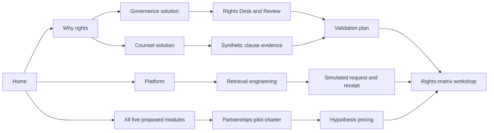
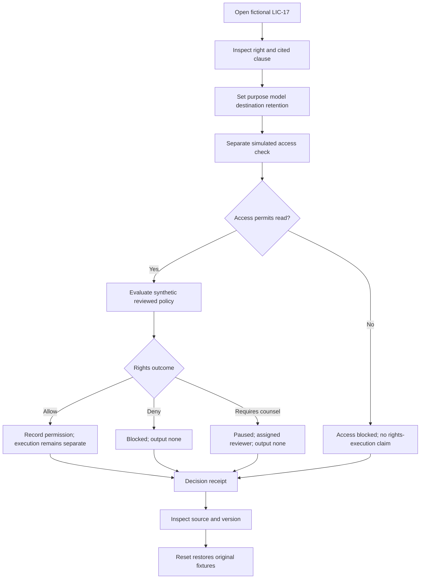

# Consent Waypoint — Website information architecture

Version 1.1 · 8 October 2026 · Companion to `CONSENT_WAYPOINT_BRAND_IDENTITY.md`

## 1. Scope and priorities

Design a connected public concept-preview company website and a separate, isolated synthetic workspace. The site explains a proposed rights operations platform; it does not claim a production product, legal interpretation service, verified customers or proven demand. All five proposed modules retain independent identities and pages. The primary conversion is **Request a rights-matrix workshop**. The secondary conversion is **Explore the synthetic demo**.

This architecture applies the supplied master guide, adapted to the original brief. `/validation` fulfills the proof-page purpose honestly. Home includes a stats strip and a testimonial design section. Invented examples are visibly labeled placeholders; verified customer stories can replace them later. No fictional customer is presented as a real endorsement. `/platform` explains potential integration boundaries without a fake integrations catalog. Capability depth sits on module pages rather than a thin `/features` route. No public registration or password recovery is needed while authentication is a clearly labeled preview.

## 2. Product inventory

| Module / route | Main user | Inputs | Proposed output | Boundary |
|---|---|---|---|---|
| Rights Desk `/products/rights-desk` | Rights owner and counsel | Approved metadata, human-entered clause citations, right and review status | Versioned rights record | No AI contract ingestion or legal conclusions |
| Rights Review `/products/rights-review` | Retrieval engineer with governance owner | Source, purpose, model, destination, retention and reviewed policy | Allow / Deny / Requires counsel plus rationale references | Complements separate access control; no guaranteed enforcement |
| Rights Proof `/products/rights-proof` | Governance and audit owner | Source references, policy version, request, decision; permitted-output reference when applicable | Decision receipt and proposed output lineage | No output lineage on denied/unresolved requests; no legal validity guarantee |
| Rights Signal `/products/rights-signal` | Rights owner | License dates, change/takedown notice, responsible owners | Expiry and propagation task workflow | Downstream deletion is unconfirmed until supported evidence exists |
| Rights Report `/products/rights-report` | Partnerships and licensing operations | Recorded usage evidence, decisions, exceptions and source attribution | Proposed usage statement and audit packet | Evaluation counts are not usage; no report is sent in demo |

Each page names its status “Proposed module.” They are not independent active plans or verified trademarks. Initial pilot: one license family, Rights Desk and shadow policy checks. The other directions remain available for investigation.

## 3. Sitemap

```text
/
├── why-rights
├── products
│   ├── rights-desk
│   ├── rights-review
│   ├── rights-proof
│   ├── rights-signal
│   └── rights-report
├── platform
├── solutions
│   ├── data-governance
│   ├── licensing-counsel
│   ├── data-partnerships
│   └── retrieval-engineering
├── validation
├── pricing
├── workshop
├── resources
│   ├── rights-matrix-guide
│   └── shadow-pilot-method
├── about
├── contact
├── trust
├── sign-in                         (access preview)
├── legal/privacy                   (draft until reviewed)
├── legal/terms                     (draft until reviewed)
├── demo                            (fixture queue)
│   ├── records/LIC-17               (rights + evidence)
│   ├── request                     (simulated evaluation)
│   ├── receipts/CW-0017             (decision evidence)
│   ├── lineage                     (separate permitted sample)
│   ├── lifecycle                   (expiry/change checklist)
│   ├── reports                     (watermarked sample packet)
│   └── dictionary                  (fixture fields and limitations)
└── custom 404
```

These are planned routes, not claims that pages already exist. Deep links must eventually work on direct load and reload. The public site and demo use different layouts and separate state/events.

## 4. Navigation and footer

Desktop header: company lockup, **Products**, **Platform**, **Solutions**, **Pricing**, **Resources**, **Company**; secondary Explore demo; primary Workshop. Use the short header action “Request a workshop,” with the full workshop name on its destination. Sign in · preview is a utility link inside Company or the demo entry region to keep the header uncluttered.

Products mega menu lists all five full module names with one-line jobs and original miniature visuals; footer/menu link text includes proposed status. Solutions groups four real buyer roles. Company groups About, Validation, Trust and Contact. Resources links only completed editorial pages. Mobile menu exposes the same destinations with expandable labeled groups, a visible close control and focus restoration; no critical destination requires hover.

Footer: five modules; platform and why-rights; four solution routes; pricing/workshop/demo; resources/validation; about/contact/trust; privacy/terms; access preview. LinkedIn and Crunchbase use official marks once supplied, with inactive “Profile not published” states until real URLs exist. No placeholder `#`, invented address, phone number or corporate registration information.

## 5. Homepage narrative and distinctive sections

The same fictional record carries the first product story. Later sections explain the complete suite, people, evaluation and commercial entry. Each chapter answers a different question and has a different composition.

| Chapter / anchor | Visitor question and content | Visual / background | Interaction and links |
|---|---|---|---|
| Hero `#overview` | What is this? Full tagline, audience, proposed status, workshop and synthetic-demo actions | Warm-white editorial split; original clause-window folio with real text overlay | Folio layers settle; skip mandatory intro; `/workshop`, `/demo` |
| Rights `#rights` | Why does access not answer every use question? Existing read gate plus five distinct rights | Lilac split panel, gate-to-matrix diagram and comparison rows | Expand one right and inspect its fictional source; `/why-rights` |
| Request `#request` | What changes with purpose, destination and retention? | Ink stage; branching route and a large request inspector | Destination switch, external inference → Requires counsel; redistribution → Deny; `/demo/request` |
| Evidence `#evidence` | Why did that decision appear? Source, review state, owner, next action and receipt | Sage chapter; source excerpt opposite decision receipt; provenance rail | Inspect clause; summary/structured receipt toggle; `/demo/records/LIC-17` |
| Modules `#modules` | What are the five proposed offers? Names, one-line jobs, status and direct page links | Five broad editorial media panels: matrix, route, chain, timeline and ledger; varied crop/scale | Module-specific preview and rail hover; each `/products/...` link visible |
| Platform `#platform` | How do the records and responsibilities connect? | Sheet canvas; horizontal architecture with dashed proposed boundaries | Highlight one flow; `/platform` |
| People `#people` | Who supplies, reviews, funds and integrates? | Paper responsibility table with role handoff strip | Select owner/counsel/partnerships/engineer; corresponding solution pages |
| Stats `#stats` | What does the concept cover? Five proposed modules, five separate rights, one source family in the initial pilot | Paper editorial number strip with oversized numerals and small explanatory diagrams | Each number links to its scope; label “Proposed scope”; optional synthetic outcome chart belongs to the demo |
| Testimonials `#testimonials` | What feedback would be useful to collect? Clearly labeled illustrative quote layouts until approved feedback exists | Lilac editorial quote spread with original role illustrations, not customer portraits or logos | Manual previous/next controls and visible source/status; persistent “Illustrative testimonial — fictional placeholder” label |
| Validation `#validation` | What evidence exists and what would justify a pilot? | Ruled scorecard; actual milestones marked Unknown/Not yet demonstrated | Expand protocol; `/validation`; actual results remain Unknown/Not yet demonstrated |
| Boundaries `#boundaries` | What must a person own, and where do guarantees stop? | Sage responsibility ledger and explicit data-boundary illustration | Row inspection; `/trust` |
| Pilot `#pilot` | What is the pricing hypothesis and pilot scope? | Warm-white typography with scoped checklist; no three-tier plan grid | Hypothetical $7,500 pilot and $2,500/mo/source-family labels; `/pricing` |
| FAQ `#questions` | Counsel approval? Entitlements? Sending to models? Expiry? Pilot readiness? | Quiet sheet reading area and grouped rows | Accessible accordion; questions addressed in full |
| Workshop `#workshop` | What is the next useful step? | Warm-white large close and folio-corner motif | “Request a rights-matrix workshop”; `/workshop` |
| Footer | Where can I find details? | Ink or paper contrasting navigation map | Complete route map and honest social states |

Do not make all product panels identical mini-dashboards. Their titles/jobs/links share alignment, but their explanatory media differ. Demo and pricing disclosures sit beside the relevant content, not only in a global disclaimer.

## 6. Dedicated product page plans

All product pages include a clear job, audience, proposed status, inputs, workflow, outputs, controls/limits, shared-platform relationship, FAQ and workshop CTA. Their layouts and visual sequences differ.

### Rights Desk — record-led editorial workbench

1. Warm-paper folio hero: “Keep approved rights close to their source.”
2. Labeled source inventory tabs: license family, owner, clause, review status and version.
3. Wide five-right table, with conditions next to each decision.
4. Split source/review pane; selecting a right reveals the exact fictional clause.
5. Version comparison using changed rows, not a generic chart.
6. Ownership checklist and one-family pilot scope; related Rights Review link; FAQ and workshop.

Signature interaction: explicit summary-to-citation flip. Scroll draws a bracket from matrix row to source passage. Reading surface remains warm paper with clause rules; source comparison can use a lilac band. Mobile uses record tabs then stacked evidence; reduced motion shows the final bracket relation.

### Rights Review — request-led decision stage

1. Ink request hero with purpose/model/destination/retention fields.
2. Access authorization gate shown separately from use-rights checking.
3. Three-outcome branch diagram with clear explanations and next actions.
4. White evidence result pane; counsel-needed state is paused, denial is blocked.
5. Shadow retrieval sequence: request → compare current practice → log ambiguity → human review.
6. Integration responsibilities and limits; related Desk/Proof links; FAQ and workshop.

Signature interaction: change destination and inspect a simulated decision. Scroll may demonstrate defaults but never overwrite a selected request. Reverse-scroll restores only passive illustrative scenes. Narrow/mobile view has labeled native controls and an outcome region announced politely.

### Rights Proof — receipt-led lineage spread

1. Lilac receipt hero: “Keep the reason with the decision.”
2. Decision receipt anatomy: request, context, source, version, review state and outcome.
3. Separate permitted synthetic-output lineage rail; derived outputs have explicit sources.
4. Citation linkage table and ancestor selection.
5. Structured sample/reading view toggle and watermarked export preview.
6. Limits: evidence does not establish legal validity or downstream enforceability; FAQ and workshop.

Signature interaction: select a lineage node to highlight ancestors. Unresolved LIC-17 external inference has a decision receipt and **Output: None**; no output node is drawn for it. Flip/toggle reveals structured receipt fields, with the same information available in static mobile form.

### Rights Signal — deadline-led operational timeline

1. Warm calendar-grid hero: “Make changing rights a visible next action.”
2. Deadline queue with owner, date, task and status.
3. Sample-date scrubber for active/approaching/expired fixtures.
4. Owner swimlane for notice → affected records → assigned action → verification.
5. In-boundary/outside-boundary propagation checklist; incomplete downstream actions remain unconfirmed.
6. Expiry/takedown limits, related Desk/Report links, FAQ and workshop.

Signature interaction: scrub an explicitly labeled sample date; expand a deadline row. Date scrubbing never changes actual browser time or performs deletion. Reduced motion updates rows without an animated sweep; mobile timeline becomes a date-ordered list.

### Rights Report — statement-led reconciliation ledger

1. Sage ledger hero: “Assemble a statement with its evidence attached.”
2. Watermarked proposed statement contents and reporting scope.
3. Sample evaluation-outcome bar chart paired with its fixture table; actual usage remains separate/unavailable.
4. Exceptions reconciliation showing unresolved, excluded and unmapped rows.
5. Clause → decision receipt → report-row mapping.
6. Audit-packet preview, no-send boundary, related Proof/Signal links, FAQ and workshop.

Signature interaction: a chart selection filters its source rows; “Preview packet” opens a labeled mock export. Total counts reconcile with fixtures. No evaluation chart is labeled usage, and no report is represented as sent to a licensor.

## 7. Supporting page plans

| Page | Required narrative / sections | Distinct evidence and interaction |
|---|---|---|
| `/why-rights` | Read/access distinction; five-use questions; existing alternatives; ambiguity; scope | Before-state process-gap diagram, comparison table and ambiguous fictional clause; light surface and one ink pause band |
| `/products` | All five names; proposed status; inputs/jobs/outputs; relationships; first pilot | Visual directory with five distinct preview media and a comparison table; links to every module |
| `/platform` | Common record schema; registry/evaluator/reviewer/receipt; expiry/report connections; integration boundaries | Broad architecture canvas, selected-route highlighting, explicit proposed connectors; no integration badges |
| `/solutions` | Four roles, handoffs, relevant modules and qualification | Responsibility map, role selector, direct role-page links |
| `/solutions/data-governance` | Rights-owner queue, metadata quality, policy versioning, accountability | Owner dashboard slice, exception table and source coverage checklist |
| `/solutions/licensing-counsel` | Approved clause entry, ambiguity, review history, escalation | Source annotation spread and review/version workflow; no automatic legal interpretation |
| `/solutions/data-partnerships` | Sponsor, one-source scope, approved inputs, possible usage statement | Pilot charter, funding/sign-off milestones and proposed report cover |
| `/solutions/retrieval-engineering` | Context fields, access vs use, shadow flow, outcome handling | Simulated structured request/response and sequence diagram; no functioning SDK promise |
| `/validation` | Current evidence level; annotation exercise; protocol; criteria; stop/go | Actual milestone register with Unknown distinct from zero, sample scorecard clearly synthetic; no customer-result implication |
| `/pricing` | Dedicated commercial page: $7,500 pilot and $2,500/mo/source-family hypotheses; inclusions; prerequisites; exclusions; all five proposed modules; FAQ | Two-stage engagement layout, scope table and readiness checklist; see detailed plan below; no checkout or price acceptance claim |
| `/workshop` | Who joins, what to discuss, minimal intake, consent, next steps and honest states | Focused form with readiness stepper, source-family context; no contract/file field |
| `/about` | Mission, current stage, human responsibility, approach | Approval-chain illustration and principle-led editorial layout; no invented founder/team history |
| `/contact` | Purpose selection, minimal fields, delivery behavior, privacy route | Quiet form and contact-topic routing; no invented email address |
| `/trust` | Synthetic isolation; data minimization; proposed controls; responsibility; limits | Data-boundary diagram plus responsibility matrix; no certifications or unimplemented controls claimed |
| `/resources` | Complete useful resources, provenance and updated dates | Document covers and topic index; no empty article routes |
| `/resources/rights-matrix-guide` | Five-right worksheet, fictional example, citation/review guidance | Annotated matrix and accessible worksheet; sample fields only |
| `/resources/shadow-pilot-method` | Annotation/sign-off, comparison method, ambiguity log, stop/go | Step sequence and evaluation template with empty actual evidence fields |
| `/sign-in` | Prototype access boundary, demo/help paths | Polished access-preview composition; no password/SSO collection or pretend successful authentication |
| `/legal/privacy` | Operator/contact TBD, minimum lead data, purpose, retention, deletion route, analytics/consent | Calm reading layout and summary ledger; draft until actual operator and processing are known |
| `/legal/terms` | Concept-preview purpose, synthetic demo, limitations, contact and policy status | Plain reading page; draft subject to counsel review |
| 404 | Useful explanation and recovery destinations | Branded missing-folio visual; Home/Products/Demo links |

Legal drafting here defines coverage rather than a legal opinion. Actual company/contact and processing details must be resolved before public form operation; do not publish invented details to make the footer look complete.

## 7A. Pricing page — detailed architecture

Pricing appears in the main navigation, footer, Home pilot section, and relevant product-page closing blocks. Keep `/pricing` as a full page.

1. **Hero:** “Start with one licensed source family.” Supporting copy explains a scoped evaluation with a rights owner and counsel. Visible status: “Proposed pricing · test hypotheses · not an active offer.”
2. **Pilot scope:** **$7,500 proposed pilot**. Show manually reviewed rights records, approved clause references, shadow policy checks and an ambiguity log. Named rights owner and counsel are prerequisites. Duration, record limits, contracting party, counsel engagement and what legal-review costs are included remain to be agreed; do not invent them.
3. **Potential ongoing engagement:** **$2,500/month per governed source family**, subject to pilot findings and an agreed scope. Define “source family” during scoping; do not imply unlimited publishers, records or requests.
4. **Scope comparison table:** pilot versus potential ongoing engagement; rows for registry, policy checks, review ownership, receipt evidence, lifecycle work, reporting and support. Mark unagreed inclusions “Scope to confirm.” Rights Proof, Signal and Report remain proposed directions, with no invented standalone prices or automatic inclusion.
5. **Prerequisites and boundaries:** owner/counsel availability, approved metadata, defined destination, shadow evaluation method and ambiguity escalation. No automated legal conclusions, downstream deletion guarantee or compliance guarantee.
6. **FAQ:** what counts as a source family, who reviews clauses, whether existing access controls are replaced, what the pilot evaluates, how expansion is scoped, and what happens with unresolved terms.
7. **CTA:** “Request a rights-matrix workshop.” No purchase button, checkout, discount countdown or unsupported “most popular” plan.

Visual direction: warm-white editorial pricing, a coral bracket around the pilot scope, and a sage comparison ledger. Scope rows expand on click; touch and keyboard expose the same content. Avoid animated price counters and revenue/savings calculators with invented assumptions.

## 7B. Stats — scope now, measured evidence later

Home receives a dedicated `#stats` section after the modules introduction. Stats distinguish scope, synthetic examples and actual outcomes.

| Type | Initial content | Required label / evidence |
|---|---|---|
| Proposed scope | **5 proposed modules** | Link to product directory; count matches the five named offers |
| Rights covered by the concept | **5 separate use rights** | Read, embed, external inference, retain, redistribute; link to rights explanation |
| Initial evaluation scope | **1 source family** | Proposed pilot scope; not a customer or deployment count |
| Optional demo chart | Example only: **10 simulated requests: 4 Allow, 3 Requires counsel, 3 Deny** | “Synthetic example — not customer results”; implement an event fixture with exactly these outcomes before displaying; never infer these counts from ten source records |
| Actual business/customer results | Not yet measured / not yet demonstrated | No invented customers, revenue, savings, latency, accuracy, risk reduction or compliance rates |

Use numerals, small diagrams and a linked source explanation. The optional outcome chart is a segmented bar with an adjacent data table and counts, not an implied performance metric. Render values directly; motion may reveal the bars once without delaying readable labels. A future verified metric needs a definition, period, denominator, source, evidence owner and approval date.

## 7C. Testimonials — labeled design placeholders

Add Home `#testimonials` after Validation and before Boundaries. Its design-preview heading is **“Illustrative feedback”** with the adjacent disclosure **“Fictional placeholders for layout exploration. No customer testimonials yet.”** This disclosure remains visible on every card, viewport, screenshot and export, including when the carousel changes.

The following are invented layout copy, not statements attributed to customers:

| Placeholder role | Illustrative quote | Visual |
|---|---|---|
| Data governance lead | “The useful question is what this source permits for this specific use.” | Original rights-matrix illustration |
| Licensing counsel | “I need the clause, its review status and the unresolved question in the same view.” | Original annotated-document illustration |
| Retrieval engineer | “A paused request should tell me which condition needs a human decision.” | Original branching-request illustration |

Label each item **“Illustrative testimonial — fictional placeholder”** and the attribution **“Example buyer role: [role]”**. Do not add invented people, company names, headshots, logos, star ratings, dates of customer use or claimed benefits. The illustrations represent the role's task and must not look like customer portraits. This section must never use “Trusted by,” “What our customers say,” or testimonial structured data while it contains placeholders.

Layout: an oversized quote panel beside three role selectors on desktop; stacked cards on mobile. Use manual controls, visible focus, no auto-rotation, and a short crossfade or instant swap for reduced motion. Keep the disclosure outside the changing quote region. An explicit “View context” action can reveal the related proposed workflow; hover alone never hides or reveals essential disclosure.

For a public launch, either retain the conspicuous fictional labels or replace the section with “Designed around your responsibilities” and unquoted buyer needs. To publish a real testimonial, obtain the exact approved quote, accurate role/company attribution, permission for name/photo/logo usage and an evidence record. Replace each item independently only when verified; do not remove all placeholder labels in a global switch. Real customer stories may later justify a `/customers` route; that route is not part of the current build.

## 8. Buyer journeys



Governance needs ownership and policy quality; counsel needs source/review integrity; engineering needs explicit contexts and outcome handling; partnerships needs bounded scope, funding and approved artifacts. Each path ends in the same workshop qualification rather than a fictional checkout.

## 9. Isolated demo IA and state flow

Persistent shell: `DEMO — SYNTHETIC DATA` and `CONCEPT PREVIEW`, source family, module navigation, sample date, Reset demo, Data dictionary and Exit demo. No customer workspace dropdown implying real tenants.

| View | Task and visible state |
|---|---|
| Queue `/demo` | 10 internally consistent fictional source records; pending, reviewed, blocked/rejected examples; owners and next actions |
| Record `/demo/records/LIC-17` | Rights matrix, conditions, source citation, review status/timestamp, owner and dated next action |
| Evidence pane | Fictional clause beside the right it supports; legal review status and ambiguity shown explicitly |
| Request `/demo/request` | Source, purpose, model, destination and retention; separately show existing access-check result |
| Decision receipt | Context, policy version, source references, outcome, execution and output state; watermarked |
| Lineage | A separate permitted sample output with sources; no output lineage for unresolved/denied external request |
| Lifecycle | Synthetic expiry dates and assigned checklist; downstream states unconfirmed where evidence is missing |
| Reports | Watermarked sample packet with reconciled fixture outcomes; no actual usage statement or sending |
| Dictionary | Entity IDs, field definitions, synthetic rules, dataset date and output limitations |



Canonical LIC-17 external inference → Requires counsel, paused, no answer. Redistribution → Deny, blocked, no answer. Read may Allow for sample internal research. Embedding is limited and conditions must be explicit; no missing metadata is treated as permission. Retention durations introduced during implementation are synthetic assumptions requiring visible labeling.

Seed design: ten fictional source records with stable IDs, fictional owners and dates around the fixed sample date 8 October 2026. Have at least one expired source, missing-condition case, unresolved external inference, rejected redistribution and permitted internal example. Review state is distinct from per-request outcome. Source records and request events have different IDs/counts. Reports derive from an explicit event fixture and reconcile totals. All exports include the fixture version and watermark. Reset clears demo selections/derived mock states only and never deletes a real lead or consent preference.

The workspace is navigable and permits explicit safe mock-state transitions; it performs no real sending, billing, model calls, third-party requests or production policy writes. No form asks for an agreement, log or secret. Demo assets and event streams stay separate from prospect data.

## 10. Workshop and contact flow

Required: work email, company, role, a concept-specific qualification question, explicit privacy consent. Qualification question: “Which licensed source family and retrieval destination would you evaluate, and can a named rights owner and counsel join?” This avoids collecting contract content. Optional structured answers may separately capture source family, destination, counsel availability, rights owner availability and preferred proposed module, including all five names. Optional interview opt-in is separate and unchecked.

Explain who should attend and what to prepare: high-level scope and approved metadata only. No unsecured agreement upload. Do not promise an exact response time before an owner commits to it.

Flow: page view → form start → labeled validation → privacy consent → submit → actual delivery success or error. A frontend-only preview instead says “Preview complete — nothing was sent.” Real success says “Request received” only after confirmed delivery. Double opt-in is used where required; `verified_signup` requires verification rather than a submit click. No workshop is marked booked without a real confirmation.

Contact uses a narrower form and the same honest delivery rule. Sign-in is an access presentation with demo/help links, not credential collection. Any future auth method requires a separate actual integration decision.

## 11. Analytics, experiment and validation IA

| Event | Trigger / meaning |
|---|---|
| `landing_view` | Consented public landing view with source/campaign context |
| `demo_open` | Open synthetic workspace; classified as demo |
| `demo_complete` | Complete defined LIC-17 request/evidence/receipt sequence; never buyer validation |
| `pricing_view` | View hypothesis pricing scope |
| `form_start` | First intentional lead-field interaction |
| `form_submit` | Confirmed actual delivery, not preview completion |
| `verified_signup` | Verified opt-in when actually applicable |
| `interview_booked` | Confirmed actual booking |

Store minimal UTM campaign/ad IDs, consent state and opaque event IDs; avoid emails/contracts in analytics payloads. Separate `environment=public` from `environment=synthetic_demo`, version demo fixtures, and dedupe actual server events by event ID. Prototype-only events stay local and carry no real success designation. Consent withdrawal stops subsequent nonessential telemetry. Instrumentation is a future implementation deliverable, not currently operating.

Validation page and experiment template track: named rights owner, counsel, consented approved artifacts, annotations, disagreement with current practice, unresolved clauses, funded sponsor/budget owner, signed pilot, escalation process and enforcement responsibility. Unknown remains Unknown, not zero.

**Advance:** a rights owner and counsel approve source metadata/clauses, agree on ambiguity handling and sign off on a funded one-family pilot. **Stop:** contracts cannot be safely represented or rights ownership/enforcement responsibility is refused. Pricing acceptance and revenue remain unvalidated. Capped LinkedIn tests are a later experiment after form/privacy QA, not part of this documentation task.

## 12. Cross-page motion contract

Home changes scenes; product pages explain one mechanism deeply; editorial/legal pages favor reading. Shared easing, controls and diagram grammar keep the identity consistent without giving every page the same layout.

| Page family | Trigger and visible change | Reverse behavior | Touch / reduced motion |
|---|---|---|---|
| Home | Clause aperture, unfolding rights, destination stage, receipt layers | Scrub scenes retrace; entrance text stays visible | Stacked chapters, complete diagrams, no pin |
| Desk | Right selection and source bracket | Selection persists across scroll | Labeled tabs and instant evidence swap |
| Review | Context selection and branch change | Visitor selection takes precedence over passive story | Native controls and static branch/result |
| Proof | Lineage node or receipt toggle | Restore selected node, not reset the request | Ancestor list and structured table |
| Signal | Sample-date scrub and task expansion | Sample time can move backward predictably | Date selector and ordered queue |
| Report | Chart selection and matched rows | Filter persists until cleared | Accessible table/filter controls |
| Platform | Route selection highlights shared schema | Current selection stays | Stacked sequence and legend |
| Solutions | Responsibility handoff reveal | Reveals remain; role selection stays | Role sections and table |
| Validation/pricing | Protocol and scope accordions | Expansion stays | Native disclosure with complete text |
| Workshop/contact | Step/errors/success based on actual interaction | Scroll never resets inputs | Standard labels, focus and state announcements |
| About/trust/resources/legal | Restrained entrance and figure selection | Reading text remains visible | Static content; no decorative delay |
| Demo | Explicit selection updates fixture state | No passive scroll mutation | Normal navigation, reset and dictionary |

Every major section has a specified entrance, meaningful interaction or complete still-state; it does not need continuous motion. Preserve keyboard navigation, readable text, native scrolling and visible focus. Flip interactions follow the brand document's explicit-toggle/inert-face rules.

## 13. Brief-to-build traceability

| Brief requirement | Home placement | Route / flow | Required future completion evidence |
|---|---|---|---|
| Five proposed offers | All five module panels | Directory + five dedicated pages + intake | Working links and five distinct page captures |
| Rights vs entitlements | Rights chapter | `/why-rights`, Review, Platform | Accurate comparison and separate access gate |
| LIC-17 matrix, context and receipt | Request/evidence | Demo record/request/receipt | Actual rendered correct states at 1440/390px |
| Counsel/source/review status | Evidence and boundaries | Desk, counsel solution, Trust | Fictional citation + review state visible |
| Provenance | Evidence rail | Proof + allowed sample lineage | No output lineage in denied/paused flow |
| Expiry/takedown | Module and boundaries | Signal + lifecycle demo | Owner/checklist and unconfirmed downstream case |
| Usage/audit packet | Report panel | Report + reports demo | Watermarked reconciled sample; no sending |
| Scope stats and sample chart | Stats chapter | `/products`, `/why-rights`, `/pricing`, optional demo report | Accurate scope counts; synthetic chart reconciles with its event fixture; no invented outcome metrics |
| Testimonial placeholders | Illustrative feedback chapter | Home `#testimonials` | Visible fictional labels on every card and capture; approved evidence required for real attribution |
| Pricing hypotheses | Pilot chapter | `/pricing` | Both supplied prices labeled test hypotheses; no checkout |
| Workshop + consent | Closing CTA | `/workshop`, privacy | All error/success/consent states tested; actual delivery status stated |
| Read-only synthetic workspace/reset/dictionary | Demo entry | Separate demo shell | Persistent ribbons, reset, no outbound fixture leakage |
| About/contact/privacy | Footer | Dedicated routes | Complete copy, correct draft/connection status |
| Social icons and complete branding | Header/footer | All public pages | Branded favicon/logo, valid or inactive social states |
| Instrumentation and experiment | Validation links | Consent-aware public events / separate demo events | Real dedupe and event evidence; no fake milestone success |
| Responsive/accessibility/performance | Entire story | Every key page/flow | Recorded real viewport, keyboard, reduced-motion and performance checks |
| Handoff/deployment | Not a marketing section | Future source/runbook/GitHub/Vercel/domain | Authorized deployment and genuine public URL; no current launch claim |

## 14. Acceptance and open operational inputs

Documentation acceptance: names and module count agree with the brief; distinct page and chapter treatments are defined; safe demo outcomes and buyer journeys are explicit; design tokens and asset rules are available; factual limits and operational gaps are recorded. This does not mark implementation or demand validation complete.

Future screenshot shot list: 1440px and 390px public hero, core request/evidence workflow, pricing, stats and labeled testimonial placeholders, demo boundary, genuine form-success state (or accurately labeled preview completion), queue/open record/receipt, plus a narrow mobile demo screen. Capture genuine browser renders with viewport/source record annotations and DEMO watermarks. Generated concept boards are not these screenshots.

Outstanding operational inputs: company/operator details and contact route; real social profiles/assets; domain/trademark review; approved privacy/terms and lead retention/deletion procedure; lead delivery destination; analytics provider/consent behavior; actual auth if later needed; repository/deployment target. These gaps do not block the brand or IA documents. They do block claims that connected forms, deployed production functions or legally reviewed notices exist.

Do not mark any requirement complete solely because this plan mentions it. Implementation QA must check links, direct routes, controls, fixtures, labels, charts, mobile, keyboard, reduced motion, network isolation, consent and actual delivery. Keep web/demo completion and buyer validation as separate milestones.
